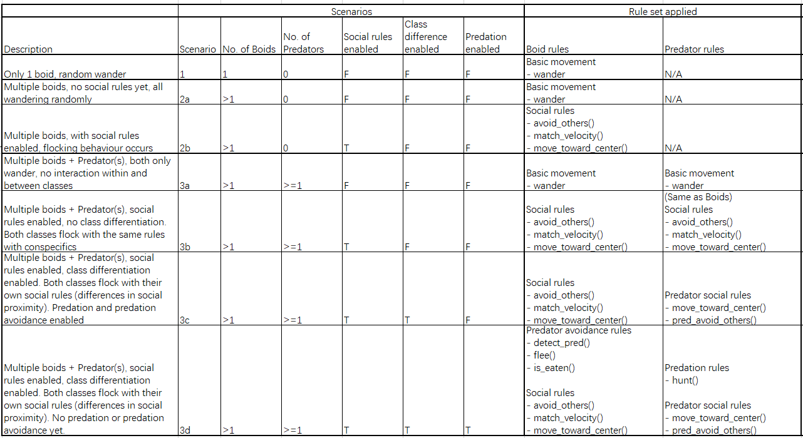

# Model overview
A modular, 2-D agent-based modelling framework. 
The goal for the finished model is to have the following functionalities:
- **Graphics mode and data collection mode** -- It can be run with a simple GUI or run without GUI, and instead collect specified data points over a specified number of simulation runs.
- **Can model environmental gradients** -- such as the depth of drying streams
- **Can model individual heterogeneity** -- such as boldness and social-proximity
- **Individual movement behaviours and interaction rules with realism**


## How it works
Upon running the model, the user can specify the number of agents (2 classes available, boids and predators) to be generated, in addition to the scenario under which the simulation is run. The model is designed to allow a variety of scenarios, with increasing complexity. In the current version, the scenario is set with 3 scenario toggles found in `config.py` -- `ENABLE_SOCIAL`, `ENABLE_CLASS_DIFF`, `ENABLE_PREDATION`.

**Scenario toggle definitions**
`ENABLE_SOCIAL`
- When disabled, there are no social interactions between agents. Each individual wanders randomly. 
- When enabled, agents start to move according to class-specific social interaction rules. For boids, these are: `avoid_others`, `match_velocity`, and `move_toward_center`, which are stored in `agent_rules.py`.
`ENABLE_CLASS_DIFF`
- When disabled, predators behave according to the same social rules as boids. 
- When enabled, predators get assigned their specific social rules, which include: `move_toward_center`, `pred_avoid_others`, these are similar to those for boids, with slightly different parameters. 
`ENABLE_PREDATION`
- When disabled, predators would not pursue the boids. There are no interspecific interactions. 
- When enabled, predators start to pursue and hunt the boids. Once the boids are within a specific distance, `CATCH_DIST` (stored in `config.py`) , of any predator, they get "eaten".

For a summary of the scenarios currently possible in this framework, see below:



# File descriptions
- `agents.py` – class definitions
- `config.py` – global parameters
- `environment.py` – geometric objects, e.g. refuge, feeding patch…
- `model.py` – the core model
- `ui_tk.py` – visualization

- `rules/boid_rules.py` – rules specific to class Boid
- `rules/predator_rules.py` – rules specific to class Predator
- `rules/shared_rules.py` – rules shared by all classes

- `temp/run_baselinemodel.py` – a script that runs the baseline model
- `temp/run_model_tk.py` – example script to run the model (i.e., entry point)
- `temp/boid_predator_v3.py` – baseline model (pre-modularization)


# How to run the model

## Clone and install
Clone the repository<br>

Create a virtual environment (optional but recommended)

Install in editable mode:
```
pip install -e .
```

## How to run the model in visualization mode
Inside the main directory, run:
```
python temp/run_model_tk.py
```
Or run the following in python:
```
from abmsim.ui_tk import run
run()
```

## How to run the model in simulation & data collection mode
To be updated...
